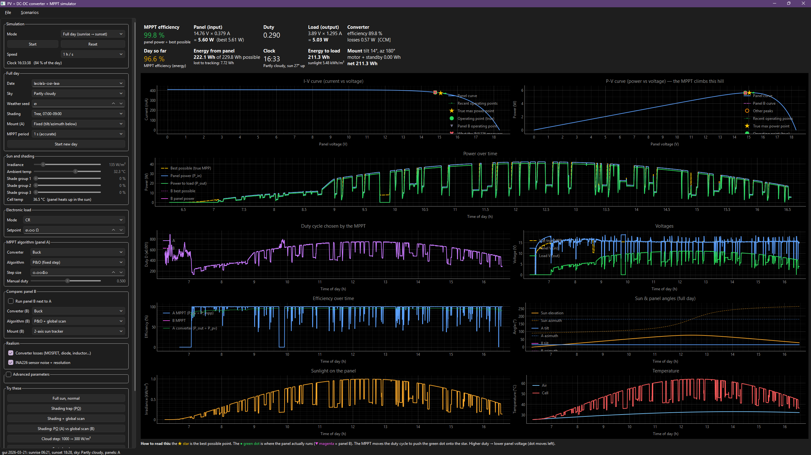

# pvsim — PV panel + buck converter + MPPT simulator

`pvsim` simulates a small photovoltaic test bench: a sun moving across a site, clear-sky and cloudy
irradiance on a fixed or tracking panel, a single-diode PV module with bypass diodes, an averaged
buck converter with a loss model, an electronic load, an INA226 current/voltage sensor, and the
MPPT algorithms that run on the ESP32 firmware. It runs interactively (GUI), headless from a
scenario JSON (`pvsim run`), or as a batch dataset generator with injected faults (`pvsim batch`).

This README documents **every formula and constant in the current build** and where each one
comes from. Each item is tagged:

| Tag | Meaning |
|---|---|
| **[VERIFIED]** | Checked against the PDF of the cited paper; page/equation given. |
| **[SIMPLIFIED]** | The paper's method, with a stated simplification. |
| **[MISMATCH]** | The code differed from the paper. All are now fixed; see [§14](#14-verification-summary). |
| **[NO PDF]** | Cited source is standard, but its PDF is not in the literature folder, so it was not re-checked. |
| **[ASSUMPTION]** | No paper backs this value; it is an engineering default to be calibrated. |

Page convention: **p.** = printed journal/book page; **pdf p.** = page number inside the PDF file
(used where the PDF has no printed numbers or the printed numbers were not extractable).


screenshot of the app

## Contents

1. [Install and run](#1-install-and-run)
2. [Architecture and signal flow](#2-architecture-and-signal-flow)
3. [Solar position](#3-solar-position-environmentsolar_positionpy)
4. [Irradiance](#4-irradiance-environmentirradiancepy)
5. [Weather: clouds and air temperature](#5-weather-clouds-and-air-temperature-environmentweatherpy)
6. [Day environment and shading](#6-day-environment-and-shading-environmentdaypy)
7. [Mounts and sun tracker](#7-mounts-and-sun-tracker-trackingmountspy)
8. [PV module](#8-pv-module-pv)
9. [Buck converter](#9-buck-converter-converterbuck_averagedpy)
10. [Electronic load and operating point](#10-electronic-load-and-operating-point)
11. [INA226 sensor model](#11-ina226-sensor-model-sensorsina226py)
12. [MPPT algorithms](#12-mppt-algorithms-mppt)
13. [Engine, energy accounting, faults and datasets](#13-engine-energy-accounting-faults-and-datasets)
14. [Verification summary](#14-verification-summary)
15. [References](#15-references)

---

## 1. Install and run

```bash
pip install -e .[gui,dev]         # numpy, scipy, pandas (+ PySide6/pyqtgraph, pytest/pvlib)
python -m pvsim.gui                # interactive GUI (live + full-day modes)
pvsim presets                      # list bundled scenarios (presets/*.json)
pvsim run presets/cloudy_day.json  # headless full day -> CSV
pvsim batch ...                    # randomised dataset with fault injection
pytest                             # test suite (some tests cross-check against pvlib)
```

---

## 2. Architecture and signal flow

```
environment/                      tracking/        pv/                 converter/         load/
 solar_position ─► irradiance ─►  mounts  ─► POA ─► panel (3 substr.) ─► buck_averaged ─► electronic_load
 weather (kc, T_amb) ──┘  day (shade events)        ▲ I-V curve           ▲ duty D
                                                   engine/operating_point: Ipv(V) = Iin(V, D)
                                                          │
                                       sensors/ina226 ─► mppt/* ─► next D
engine/live.py (one MPPT step)  ·  engine/day_runner.py (whole day, energy totals)
scenario/ (JSON, runner, CLI)   ·  data/ (faults, batch generator, recorder, CSV export)
```

Per MPPT period `dt` (default 0.1 s in live mode):

1. Environment gives sun position, POA irradiance per substring and ambient temperature.
2. Cell temperature → single-diode parameters → module I-V curve (with bypass diodes).
3. The operating point is the intersection of the PV curve with the converter input
   characteristic at duty `D` (quasi-static: converter is in periodic steady state).
4. The INA226 model quantises and adds noise to `(V, I)`.
5. The MPPT algorithm returns the next duty.

---

## 3. Solar position (`environment/solar_position.py`)

Implements the **NOAA Solar Calculator** algorithm, which is a simplified form of
**Meeus, *Astronomical Algorithms***. **[VERIFIED]** against Meeus (1991, 1st ed.; pdf page =
printed page + 5):

- L0, M, e, C, Ω and the apparent-longitude correction `− 0.00569 − 0.00478 sin Ω`: ch. 24,
  eqs. 24.2–24.4 and text, pp. 151–153. The ε correction `+ 0.00256 cos Ω`: eq. 24.8, p. 152.
- Mean obliquity ε0: eq. 21.2, p. 135.
- Equation of time: eq. 27.3, p. 173.

The code uses the **2nd-edition (1998) coefficients, taken from NOAA**. They differ from the
1991 book in the 5th–6th decimal. The 1991 values are:

- `L0 = 280.46645`
- `M = 357.52910 + 35999.05030T − 0.0001559T²`
- `e = 0.016708617 − … − 0.0000001236T²`
- `C` coefficients `1.914600` and `0.000290`

The effect is far below 0.01°. The test suite also checks the code against
`pvlib.solarposition`; the two agree to well under 0.1°.

Julian day `JD`, Julian century `jc = (JD − 2451545)/36525`.

| Quantity | Formula (degrees unless noted) |
|---|---|
| Geometric mean longitude | `L0 = 280.46646 + jc(36000.76983 + 0.0003032 jc)  mod 360` |
| Mean anomaly | `M = 357.52911 + jc(35999.05029 − 0.0001537 jc)` |
| Orbit eccentricity | `e = 0.016708634 − jc(0.000042037 + 1.267e-7 jc)` |
| Equation of centre | `C = sinM(1.914602 − jc(0.004817 + 0.000014 jc)) + sin2M(0.019993 − 0.000101 jc) + 0.000289 sin3M` |
| Apparent longitude | `λ = L0 + C − 0.00569 − 0.00478 sin Ω`,  `Ω = 125.04 − 1934.136 jc` |
| Mean obliquity | `ε0 = 23 + (26 + (21.448 − jc(46.815 + jc(0.00059 − 0.001813 jc)))/60)/60` |
| Corrected obliquity | `ε = ε0 + 0.00256 cos Ω` |
| Declination | `δ = asin(sin ε · sin λ)` |
| Equation of time [min] | `EoT = 4·deg( y sin2L0 − 2e sinM + 4ey sinM cos2L0 − ½y² sin4L0 − 1.25e² sin2M )`, `y = tan²(ε/2)` |
| True solar time [min] | `TST = (minutes_UTC + EoT + 4·lon) mod 1440` |
| Hour angle | `H = TST/4 − 180` |
| Zenith | `cos z = sinφ sinδ + cosφ cosδ cosH` |
| Azimuth | clockwise from north, 0–360° |

**Atmospheric refraction** (added to elevation `h`, `te = tan h`, result in arcsec / 3600).
**[NO PDF]**: this piecewise fit comes from NOAA, not from Meeus. Meeus ch. 15, p. 101 gives the
Bennett/Saemundsson formulas 15.1–15.2 instead. The NOAA notes are not in the folder.

| Elevation | Correction [arcsec] |
|---|---|
| `h > 5°` | `58.1/te − 0.07/te³ + 0.000086/te⁵` |
| `−0.575° < h ≤ 5°` | `1735 + h(−518.2 + h(103.4 + h(−12.79 + 0.711h)))` |
| `h ≤ −0.575°` | `−20.772 / te` |

Sunrise/sunset use zenith **90.833°** (refraction + solar disc radius; NOAA convention,
**[NO PDF]**); solar noon
`= 720 − 4·lon − EoT + 60·tz` minutes local.

**Default site — [ASSUMPTION]:** Pathum Thani, Thailand: 14.07° N, 100.60° E, UTC+7, altitude 5 m.
Default date 2026-03-21 (equinox).

---

## 4. Irradiance (`environment/irradiance.py`)

### 4.1 Extraterrestrial irradiance

```
E0 = S · (1.00011 + 0.034221 cos b + 0.00128 sin b + 0.000719 cos 2b + 0.000077 sin 2b)
b  = 2π (doy − 1)/365
```

- Earth–Sun distance factor: **Spencer (1971)** Fourier series. **[VERIFIED]** as reproduced
  in Duffie & Beckman (5th ed.), eq. 1.4.1b, p. 9, with `B = (n − 1)·360/365` (eq. 1.4.2).
  D&B prints the cos 2B coefficient as `0.00719`, a known misprint; Spencer (via Iqbal) gives
  `0.000719`, as the code does. There is no standalone Spencer PDF.
- Solar constant `S = 1360.8 W/m²`: **[VERIFIED]** Kopp & Lean (2011), abstract
  ("1360.8 ± 0.5 W m⁻²", pdf p. 1).

### 4.2 Relative optical air mass

```
AM = 1 / ( cos z + 0.50572 · (96.07995 − z)^(−1.6364) )      z in degrees
```

**[VERIFIED]** Kasten & Young (1989), approximation formula with coefficients
a = 0.50572, b = 6.07995° (i.e. 90 + b = 96.07995), c = 1.6364, p. 4737.

### 4.3 Clear-sky GHI / DNI / DHI — Ineichen–Perez

With site altitude `h` [m] and Linke turbidity `TL` (default: monthly Remund value for the date, see below):

```
AM_abs = AM · exp(−h/8434.5)
fh1 = exp(−h/8000),     fh2 = exp(−h/1250)
cg1 = 5.09e-5·h + 0.868,     cg2 = 3.92e-5·h + 0.0387

GHI = cg1 · E0 · cos z · exp(−cg2 · AM_abs · (fh1 + fh2(TL − 1)))
DNI = (0.664 + 0.163/fh1) · E0 · exp(−0.09 · AM_abs · (TL − 1))
DNI ≤ GHI · (1 − (0.1 − 0.2·e^(−TL)) / (0.1 + 0.88/fh1)) / cos z
DHI = GHI − DNI · cos z
```

**[VERIFIED]** Ineichen & Perez (2002):

- GHI is eq. 11, with `cg1`, `cg2`, `fh1`, `fh2` from the nomenclature, p. 156.
- Beam is eq. 8, with `b = 0.664 + 0.163/fh1` and `fh1 = exp(−h/8000)`, p. 154.
- AM is the "altitude corrected air mass (Kasten and Young, 1989)" (eq. 1, p. 151). That is why
  the code uses `AM_abs`.
- The DNI cap is Appendix A, p. 157, with `0.88/fh1` as printed in the paper. pvlib uses
  `0.882/fh1` (`clearsky.py` line 133); the code follows the paper (fixed, see §14.1 #3).
- The scale height `8434.5 m` in `AM_abs` is not in Ineichen & Perez. Remund et al. (2003) use
  `exp(−h/8435.2)` (eq. 3). The difference is negligible.

The test suite also compares GHI/DNI/DHI with pvlib.

**TL: [VERIFIED], monthly Remund et al. (2003) climatology, interpolated by day.** The paper's
station table has no Thai station. The text notes high turbidity at tropical stations before the
rainy season. The worldwide monthly maps built on that work ship with pvlib
(`clearsky.lookup_linke_turbidity`). At the default site (14.07° N, 100.60° E) they give (`LINKE_MONTHLY` in `irradiance.py`):

| Jan | Feb | Mar | Apr | May | Jun | Jul | Aug | Sep | Oct | Nov | Dec | mean |
|---|---|---|---|---|---|---|---|---|---|---|---|---|
| 3.55 | 3.75 | 4.35 | 4.80 | 5.00 | 5.20 | 5.25 | 5.30 | 5.00 | 4.55 | 4.05 | 3.80 | **4.55** |

For comparison, the annual means are 4.51 for Bangkok, 4.63 for Chiang Mai and 4.14 for Hat Yai.
`linke_turbidity(day)` treats each value as the mid-month value and interpolates linearly by
day of year, wrapping December→January, exactly as pvlib does with `interp_turbidity=True`
(a test compares the two). `DayEnvironment` uses it unless `WeatherConfig.linke` is set to a
fixed number. The table is only valid near the default site; for another site, replace it with
pvlib's `lookup_linke_turbidity` values for that location.

### 4.4 Diffuse fraction — Erbs

Clearness index `kt = GHI / (E0 cos z)`, capped at 1:

```
kd = 1 − 0.09 kt                                                   kt ≤ 0.22
kd = 0.9511 − 0.1604 kt + 4.388 kt² − 16.638 kt³ + 12.336 kt⁴      0.22 < kt ≤ 0.80
kd = 0.165                                                          kt > 0.80
DHI = kd · GHI,     DNI = (GHI − DHI)/cos z
```

**[VERIFIED]** Erbs, Klein & Duffie (1982), eq. 1, p. 294 — coefficients match exactly.
Erbs fitted *hourly* data; applying it at 1-s resolution under moving cloud is outside its
fitted range (**[SIMPLIFIED]**). For `z ≥ 87°` everything is treated as diffuse
(**[ASSUMPTION]**, guards the `1/cos z` blow-up near sunrise/sunset).

### 4.5 Angle of incidence

```
cos θ = cos z cos β + sin z sin β cos(γs − γ)
```

β = panel tilt, γ = panel azimuth, γs = sun azimuth. **[VERIFIED]** Duffie & Beckman (5th ed.),
eq. 1.6.3, p. 15; the same form is eq. 2 in Hay (1993), p. 373. The code also uses it for tracker
pointing error.

### 4.6 Plane-of-array irradiance — Hay–Davies

```
Ai  = DNI / E0                                     anisotropy index
Rb  = max(cos θ, 0) / max(cos z, cos 89°)          (cos 89° = 0.01745, pvlib's cap)
sky    = DHI · ( Ai·Rb + (1 − Ai)(1 + cos β)/2 )
ground = GHI · ρ · (1 − cos β)/2,                  ρ = 0.2
POA    = DNI · max(cos θ, 0) + sky + ground
```

- Model: **[VERIFIED]** Hay & Davies (1980). I did not find the original workshop paper, so I
  checked it against two sources that reproduce it:
  - **Hay (1993)**:
    - Anisotropy index `k = S/So`: eq. 7, p. 376.
    - Sky diffuse `Ed[k cos i/cos z + 0.5(1 − k)(1 + cos β)]`: eq. 8, p. 376.
    - Isotropic term: eq. 5, p. 374.
    - Ground-reflected term `0.5·ρ·Eg·(1 − cos β)`: eq. 6, p. 374.
  - **Duffie & Beckman (5th ed.)**, §2.16, pp. 93–94: eqs. 2.16.2–2.16.4, with
    `Ai = Gbn/Gon`.

  The code is also cross-checked against `pvlib.irradiance.haydavies`.
- Albedo ρ = 0.2: **[ASSUMPTION]** (common grass/soil default).
- The 89° cap on `cos z` comes from pvlib, not from the paper. In pvlib's `irradiance.py` it is
  `np.maximum(cos_solar_zenith, 0.01745)  # GH 432`. D&B's Perez model has a similar guard,
  `max(cos 85°, cos z)` (eq. 2.16.9, p. 94).
- That diffuse light can favour a flatter panel over a sun-pointing one is checked in
  `tests/test_tracking.py` and is **[VERIFIED]** against Kelly & Gibson (2009), abstract, p. 2092:
  under overcast conditions "tilting a solar module … away from the zenith reduces the irradiance
  relative to a horizontal configuration".

---

## 5. Weather: clouds and air temperature (`environment/weather.py`)

### 5.1 Clear-sky index time series

All-sky GHI is `GHI = kc(t) · GHI_clear(t)`, then split with Erbs (§4.4).

`kc(t)` is built on a 1-s grid:

1. Start from the sky's `base_kc`.
2. Cloud arrivals are Poisson: exponential inter-arrival times with rate `clouds_per_hour/3600`.
3. Each cloud lasts an exponential time with mean `mean_duration_s` and has a depth drawn
   uniformly from `depth = (lo, hi)`; inside it `kc = depth`.
4. Overlapping clouds combine with `kc = min(...)`.
5. Cloud edges are smoothed with a moving average of `edge_s` seconds, then `kc ≥ 0`.

**Basis — [SIMPLIFIED]:** Morf (1998) STSIM models the sunshine indicator as a
"recurrent homogeneous Markov process with two states" that needs only the mean durations of
clouded and sunny periods (pdf p. 1), with a memoryless transition matrix (pdf p. 3) and
exponentially decaying autocorrelation (pdf p. 5). The code realises the same two-state,
exponential-holding-time idea with Poisson arrivals. Differences:
clear spells are exactly exponential only when clouds don't overlap; the cloudy-state level is a
uniform draw, not Morf's fitted distribution; edge smoothing is added.
Bright et al. (2015) (pdf pp. 2–3) build Markov chains on okta/pressure/wind/cloud height; the
code uses only the general Markov-weather idea.

**Morf (2011) STSCCM: [SIMPLIFIED].** The model is "a Homogeneous Recurrent Markov Process with
two states operating in a time step Δt with a transition probability matrix" (pdf p. 3;
App. A.1, pdf p. 12). Morf derives that matrix from cloud cover and sunshine statistics. The code
uses preset rates instead. The code's Poisson arrivals with exponential durations are the
continuous-time form of the same two-state chain: as Δt → 0, geometric holding times become
exponential. So the structure matches, but the parameters do not come from Morf.

**Sky presets — all values [ASSUMPTION]**, to be calibrated against measured kc:

| Sky | base_kc | clouds/h | mean duration [s] | depth (kc) | edge [s] | t_swing |
|---|---|---|---|---|---|---|
| clear | 1.00 | 0 | 60 | 0.90–1.00 | 10 | 1.0 |
| partly_cloudy | 1.00 | 8 | 120 | 0.25–0.60 | 15 | 0.9 |
| cloudy | 0.85 | 20 | 300 | 0.20–0.50 | 30 | 0.7 |
| overcast | 0.30 | 6 | 600 | 0.15–0.30 | 120 | 0.4 |

`sky = "random"` draws with probabilities (0.25, 0.40, 0.25, 0.10) **[ASSUMPTION]**.

### 5.2 Air temperature — Parton & Logan

Constants from **[VERIFIED]** Parton & Logan (1981), Table 1, air temperature at 150 cm:
`a = 1.86 h` (lag of Tmax after solar noon), `b = 2.20` (night decay), `c = −0.17 h`
(lag of Tmin after sunrise).

Daytime (from `sunrise + c` until sunset), with `Y` = day length and `m` = hours since `sunrise + c`:

```
T(m) = Tmin + (Tmax_eff − Tmin) · sin( π m / (Y + 2a) )     ← code = paper, eq. 1, p. 206
```

Night (after sunset), with `Tsn` = temperature at sunset and `n` = hours since sunset:

```
T(n) = Tmin + (Tsn − Tmin) · exp(−b n / Z)
Z = 24 − Y          ← code = paper, eq. 2, p. 206 (and Fortran listing, pp. 214–215)
```

**[VERIFIED]** — both formulas now match the paper (fixed, see §14.1). Tmax occurs at
`sunrise + c + (Y + 2a)/2`; a test checks this.

Sky effect on daily range: `Tmax_eff = Tmin + (Tmax − Tmin) · t_swing`. Supported in direction
by Dai, Trenberth & Karl (1999): low clouds are "most efficient in reducing the daytime maximum
temperature and DTR" (abstract, pdf p. 1; also pdf p. 22). The `t_swing` numbers themselves are
**[ASSUMPTION]**.

Defaults **[ASSUMPTION]** (Bangkok-area dry season): `Tmin = 25.5 °C`, `Tmax = 34.0 °C`.

---

## 6. Day environment and shading (`environment/day.py`)

Irradiance is evaluated on an `env_dt = 1 s` grid. Shade objects block **beam** irradiance on
individual substrings. With beam-on-plane `Pb = DNI cos θ`:

```
shade_k(t) = depth_k · ramp(t) · Pb / POA
ramp(t)    = clip( min(1, (t − t_start)/r, (t_end − t)/r), 0, 1 )
G_k        = POA · (1 − shade_k)
```

So a shadow removes the beam fraction of that substring's light, and fades in/out over `r` s.
This is a geometric simplification (no penumbra or diffuse-sky obstruction) **[ASSUMPTION]**.

Shade presets **[ASSUMPTION]** (depth per substring 1..3):

| Preset | Window | Depths | Ramp |
|---|---|---|---|
| tree_morning | 07:00–09:00 | (0.8, 0.3, 0) | 900 s |
| pole_noon | 11:30–12:30 | (0, 0.7, 0) | 300 s |
| building_evening | 16:00–18:30 | (0, 0.6, 0.95) | 1200 s |

For the I-V curve cache, `G` is rounded to 0.5 W/m² and `T` to 0.05 °C (numerical choice).

---

## 7. Mounts and sun tracker (`tracking/mounts.py`)

- **Fixed mount** default: tilt 14°, azimuth 180° (south) **[ASSUMPTION]** — tilt ≈ site
  latitude, the usual rule of thumb.
- **Dual-axis tracker** target: `tilt = min(z, tilt_max)`, `azimuth = γs`.
  Pointing error between panel normal and sun = AOI (§4.5).
  It moves when the error exceeds a deadband; each axis slews at a fixed speed; below a minimum
  sun elevation it stows flat.

| Parameter | Value | Tag |
|---|---|---|
| deadband | 2° | ASSUMPTION |
| slew speed | 0.5 °/s per axis | ASSUMPTION |
| tilt_max | 80° | ASSUMPTION |
| motor power while moving | 4 W | ASSUMPTION |
| standby power | 0.3 W | ASSUMPTION |
| stow | sun elevation < 3° → tilt 0°, azimuth 90° | ASSUMPTION |

Tracker energy: `E_mount = Σ (P_standby·dt + P_motor·t_move) / 3600` [Wh].

---

## 8. PV module (`pv/`)

### 8.1 Single-diode model

For one series string of `Ns` cells:

```
I = Iph − I0·( exp((V + I·Rs)/a) − 1 ) − (V + I·Rs)/Rsh,       a = n·Ns·k·T/q
```

**[VERIFIED]** Villalva, Gazoli & Filho (2009), eq. 3, pdf p. 3 (with `Vt = Ns k T/q`,
eq. 3 and text). Constants: `q = 1.602176634e-19 C`, `k = 1.380649e-23 J/K` (exact SI values).

### 8.2 Parameter extraction from the datasheet (`pv/datasheet.py`)

Unknowns: `Iph, I0, Rs, Rsh` for a fixed ideality factor `n`. Three datasheet points
(short circuit, open circuit, MPP) plus `dP/dV = 0` at the MPP give four equations.

From the short-circuit and open-circuit conditions (linear in `Iph`, `I0`):

```
I0  = ( Isc(1 + Rs/Rsh) − Voc/Rsh ) / ( exp(Voc/a) − exp(Isc·Rs/a) )
Iph = Voc/Rsh + I0·( exp(Voc/a) − 1 )
```

Remaining residuals in `(Rs, Rsh)`:

```
r1 = Iph − I0(exp((Vmp + Imp·Rs)/a) − 1) − (Vmp + Imp·Rs)/Rsh − Imp        (MPP lies on the curve)
r2 = dI/dV|mp + Imp/Vmp,   dI/dV = −g/(1 + g·Rs),  g = (I0/a)·exp(Vd/a) + 1/Rsh
                                                                         (dP/dV = 0 ⇔ dI/dV = −I/V)
```

Solved with `scipy.optimize.fsolve` on `(log Rs, log Rsh)`, 5 starting guesses, accepted if
`|r| < 1e-8`. `n` is tried in order 1.3, 1.2, 1.4, 1.1, 1.5, 1.0, 1.6, 1.8, 2.0.

- **[VERIFIED]** Villalva et al. (2009): Isc/Voc/MPP conditions eq. 4–6 and I0 form eq. 7
  (pdf p. 4); "1 ≤ a ≤ 1.5" (pdf p. 4); iterative Rs/Rsh fit (eq. 8, pdf p. 5; eq. 10, pdf p. 6).
- **[SIMPLIFIED]** Villalva matches `Pmax` by iterating Rs; the code instead imposes `dP/dV = 0`
  directly, as in De Soto et al. (2006), eq. 6a, p. 80. The code's I0 generalises Villalva eq. 7
  to keep the Rsh term. Trying `n` up to 2.0 goes beyond Villalva's 1–1.5 and is only a fallback.

Default panel **[ASSUMPTION]** — generic 50 W, 36-cell mono module, 3 bypass diodes:

| Voc | Isc | Vmp | Imp | Pmax | αIsc | βVoc | γPmax | NOCT | bypass Vf |
|---|---|---|---|---|---|---|---|---|---|
| 21.6 V | 3.0 A | 18.0 V | 2.78 A | 50 W | +0.05 %/K | −0.32 %/K | −0.42 %/K | 45 °C | 0.45 V |

Plausibility of the ratios:
- `Vmp/Voc = 0.833` vs. fractional-OCV constant **Kpv = 0.816** measured by Baimel et al. (2019):
  **[VERIFIED]** table on pdf p. 8 (0.816/0.815 for 1000–200 W/m²), pdf p. 9, pdf p. 12
  (0.816 → 0.789 at 65 °C).
- `Imp/Isc = 0.927` vs. FSCC "k values … typically close to 0.9 to 0.98": **[VERIFIED]**
  Suryakumari (2013), pdf p. 5 (low-impact venue; background only).

### 8.3 Translation to operating conditions (`params_at`)

```
Iph = (G/Gref)·(Iph_ref + αIsc·ΔT)          De Soto eq. 1 / Villalva eq. 4
a   = a_ref · T/Tref                         De Soto eq. 2
I0  = (Iph(Gref,T) − Voc(T)/Rsh) / (exp(Voc(T)/a) − 1),   Voc(T) = Voc + βVoc·ΔT    Villalva eq. 7
Rsh = Rsh_ref · Gref/G                       De Soto eq. 5
Rs  = Rs_ref                                 De Soto eq. 4
Gref = 1000 W/m²,  Tref = 298.15 K
```

- **[VERIFIED]** De Soto, Klein & Beckman (2006), eqs. 1–5, p. 80.
- **[SIMPLIFIED]** De Soto's air-mass modifier `M` (eq. 11, ≈p. 81) and incidence-angle modifier
  (eq. 12, p. 82) are omitted: POA is used as effective irradiance.
- **[SIMPLIFIED]** I0(T) uses Villalva's eq. 7 (honours the datasheet βVoc exactly) instead of
  De Soto eq. 3 (`I0 ∝ T³ exp(−Eg/kT)`).

### 8.4 Cell temperature — NOCT

```
Tc = Ta + (NOCT − 20)/800 · G
```

**[VERIFIED]** Skoplaki & Palyvos (2009), Table 3, p. 26 (NOCT correlation; 45 °C typical).
Wind speed and mounting are ignored **[SIMPLIFIED]**. Duffie & Beckman (5th ed.) give the full
form in eq. 23.3.3, p. 774:

```
Tc = Ta + (G/G_NOCT)·(T_NOCT − Ta,NOCT)·(U_L,NOCT/U_L)·(1 − ηc/τα)
```

The NOCT conditions are 800 W/m², 1 m/s wind and 20 °C ambient (p. 773). The code sets both
correction ratios to 1. Dropping `(1 − ηc/τα)` overestimates Tc by a few °C at full sun: about
5 °C at 1000 W/m² for ηc ≈ 15 %.

### 8.5 Explicit solutions — Lambert W (`pv/single_diode.py`)

```
I(V) = (Rsh(Iph + I0) − V)/(Rs + Rsh)
       − (a/Rs) · W( Rs·Rsh·I0/(a(Rs + Rsh)) · exp( Rsh(Rs(Iph + I0) + V) / (a(Rs + Rsh)) ) )

V(I) = Rsh(Iph + I0) − I(Rs + Rsh) − a · W( (Rsh·I0/a) · exp( Rsh(Iph + I0 − I)/a ) )
```

**[VERIFIED]** Jain & Kapoor (2004), eq. 2 (p. 270) and eq. 3 (p. 271).
Numerics: the W argument overflows float64, so `W(e^x)` is computed from `x`
(`lambertw_exp`): scipy for `x < 300`, else Newton iterations on `w + ln w = x`.

### 8.6 Substrings, bypass diodes and the module curve (`pv/panel.py`)

The 36 cells form 3 substrings of `m = 12` cells, each with its own irradiance and a bypass diode.
Substring parameters: `a, Rs, Rsh` scaled by `m/Ns`; `Iph, I0` unchanged (series cells carry
the same current).

```
V_module(I) = Σk max( V_k(I), −Vf )          Vf = 0.45 V
```

A substring with `Iph ≤ 0` (fully dark) contributes `−Vf` whenever `I > 0`. A shorted bypass
diode (fault) removes its substring from the sum.

- **[VERIFIED]** Silvestre, Boronat & Chouder (2009): one bypass diode per group of series cells,
  the protected group is bypassed when reverse-biased (pdf pp. 3–4, Figs. 8–9).
- **[VERIFIED]** Bishop (1988): bypass diodes "limit the reverse biasing of current-mismatched
  cells" (pdf p. 2).
- **[SIMPLIFIED]** Reverse bias of a shaded substring is limited only by Rsh and the bypass clamp;
  Bishop's avalanche-breakdown term is not modelled.

Curve sampling: 400 linear current points plus 120 geometrically spaced points near each
substring's `Iph` (where the bypass knees are). Local maxima are found with
`scipy.signal.find_peaks` (prominence 0.5 % of Pmax), then refined in the current domain
(64-point grid, 3 zoom passes). These are numerical choices.

---

## 9. Buck converter (`converter/buck_averaged.py`)

Averaged, steady-state model following **Erickson & Maksimovic, *Fundamentals of Power
Electronics*, 3rd ed.** (printed page = pdf page − 16).

### 9.1 Continuous conduction mode (CCM)

Equivalent circuit: ideal DC transformer `1:D`, source `E`, series resistance `Req`.

```
E   = D·Vin − (1 − D)·Vf                       (asynchronous; Vf = 0 if synchronous)
Req = D·Rds + RL  (+ (1 − D)·Rds_low if synchronous)
Vout from the load line,  Iout = load current
ΔIL = (Vin − Vout − Iout·Req) · D / (L·fsw)     peak-to-peak ripple
```

- Ripple: **[VERIFIED]** eq. 2.15–2.16, pp. 21–22 (`ΔiL = (Vg − V)DTs/2L` is the
  half-ripple; the code uses peak-to-peak, i.e. 2·ΔiL, and subtracts the resistive drop).
- Loss-element averaged model (Rds, RL, diode Vf in the equivalent circuit): ch. 3
  (inductor copper loss, pdf p. 61 → p. 45 onward). Page checked for the method, not for
  each combined expression.

**CCM losses** with `IL_rms² = Iout² + ΔI²/12`:

| Loss | Formula |
|---|---|
| High-side switch conduction | `D · IL_rms² · Rds` |
| Inductor DCR | `IL_rms² · RL` |
| Output capacitor ESR | `(ΔI²/12) · ESR_out` |
| Input capacitor ESR | `(D·IL_rms² − (D·Iout)²) · ESR_in` |
| Switching (linear V/I overlap) | `½ · Vin · Iout · (tr + tf) · fsw` |
| Gate drive | `Qg · Vg · fsw` |
| Freewheel diode / low-side FET | `(1 − D)·Iout·Vf`  or  `(1 − D)·IL_rms²·Rds_low` |

Rms values for a triangular ripple and the input-capacitor current are standard
textbook results (Erickson ch. 2 and Appendix A). The switching-overlap and gate-charge
expressions are the standard first-order estimates; Erickson ch. 4 treats switching loss in more
detail (diode recovery, capacitances) — **[SIMPLIFIED]**.

### 9.2 Discontinuous conduction mode (DCM, asynchronous only)

DCM is entered when `Iout < ΔIL/2` — equivalent to Erickson's `K < Kcrit(D)`, eq. 5.6,
p. 136, and the CCM/DCM boundary eq. 5.30–5.31, p. 144. **[VERIFIED]**

```
Ipk  = (Vin − Vout) · D / (L·fsw)
D2   = min( (Vin − Vout)·D / (Vout + Vf),  1 − D )        volt-second balance with diode drop
Iout = Ipk · (D + D2)/2                                    charge balance → solved for Vout with brentq
IL_rms² = Ipk² (D + D2)/3,      I_sw_rms² = Ipk²·D/3
P_sw    = ½ · Vin · Ipk · tf · fsw                         (turn-on at zero current)
P_diode = Vf · Ipk · D2 / 2
```

Method: Erickson ch. 5, §5.2 (buck DCM by inductor volt-second and capacitor charge balance,
pp. 136–144) — section **[VERIFIED]**; the individual DCM equation numbers were not page-checked.
Including `Vf` in D2 extends the ideal-diode textbook case. Rms values use the triangular-pulse
formula `I²·duty/3`.

### 9.3 Input current

```
Iin = (Pout + Σ P_loss) / Vin
```

(power balance of the averaged model).

**Component defaults — all [ASSUMPTION]** (typical hobby-scale buck):
L 220 µH, RL 0.05 Ω, Cin = Cout = 470 µF, ESR 0.05 Ω, Rds 0.03 Ω, Vf 0.45 V, fsw 40 kHz,
tr = tf = 40 ns, Qg 20 nC, Vg 10 V, Dmax 0.95, UVLO 5 V.

---

## 10. Electronic load and operating point

### 10.1 Electronic load (`load/electronic_load.py`)

| Mode | Current drawn at voltage V |
|---|---|
| CR | `I = V / R` |
| CC | `I = Iset · min(1, V / v_min)` |
| CV | `I = clip( (V − Vset)/r_cv, 0, i_max )` |

`v_min = 0.5 V`, `r_cv = 0.02 Ω`, `i_max = 10 A`, default CR 5 Ω (live channel uses CR 3 Ω)
— **[ASSUMPTION]**, idealised bench-load behaviour. The intersection with the converter's
Thevenin output `(E, Req)` is solved in closed form for each mode.

### 10.2 PV ↔ converter operating point (`engine/operating_point.py`)

Find `V` with

```
f(V) = Ipv(V) − Iin(V, D) = 0
```

using `brentq` on brackets of the sampled curve. If several roots exist, take the one nearest
the previous operating point (warm start), else the highest stable root. If no root exists
above UVLO the input **collapses** (output off). Numerical method, no citation needed.

**MPP reachability.** For a buck, `Rin ≈ Rload / D²`, so the lowest PV voltage the converter can
pull is `Vpv(Dmax)`. The MPP is reported reachable iff `Vpv(Dmax) ≤ Vmpp·(1 + 0.01)`
(1 % tolerance is **[ASSUMPTION]**). The `Rin = R/D²` relation follows from the ideal CCM buck
conversion ratio `M = D` (Erickson ch. 2).

---

## 11. INA226 sensor model (`sensors/ina226.py`)

Register model per **Texas Instruments INA226 datasheet (SBOS547C)**. **[VERIFIED]**: every value
in the table matches the datasheet.

- Bus voltage LSB and full scale: §6.3.1, pdf p. 10, and the footnote on pdf p. 6. The rated
  maximum is 36 V.
- Shunt range, offsets, gain error and conversion times: electrical characteristics table,
  pdf p. 5.
- Averaging and conversion timing: §6.4.1, pdf p. 13. The datasheet example (588 µs on both
  channels, averaging 4 → about 4.7 ms) confirms the code's sample time `avg·(t_bus + t_shunt)`.
- `CAL = 0.00512/(Current_LSB·R_shunt)` and power LSB = 25 × current LSB: eq. 1, pdf p. 15.
- AVG settings: Table 7-3.

The noise σ values are **[ASSUMPTION]**.

| Quantity | Value |
|---|---|
| Bus voltage LSB / full scale | 1.25 mV / 40.96 V |
| Shunt voltage LSB / full scale | 2.5 µV / 81.92 mV |
| Averaging | 1, 4, 16, 64, 128, 256, 512, 1024 |
| Conversion time | 140 µs … 8.244 ms |
| Power LSB | 25 × current LSB |

Noise: Gaussian with σ scaled as `σ0 · (1/√avg) · √(1.1 ms / t_conv)` (averaging and longer
integration reduce white noise). `σ0,bus = 2 mV` and `σ0,shunt = 5 µV` are **[ASSUMPTION]**.
Defaults: `R_shunt = 0.01 Ω`, `avg = 16` **[ASSUMPTION]**. Measured values are clipped to full
scale and quantised to the LSB.

---

## 12. MPPT algorithms (`mppt/`)

Common defaults **[ASSUMPTION]**: `d_init = 0.5`, fixed step `ΔD = 0.005`, `d_max = 0.95`.
Duty is the control variable (direct duty control, as in the firmware).

### 12.1 Perturb & Observe (`po.py`)

Keep perturbing in the same direction while power rises; reverse when `ΔP < 0`.

**[VERIFIED]** Femia, Petrone, Spagnuolo & Vitelli (2005), TPEL 20(4):963–973. Femia's main
result is that the sampling interval `Ta` must exceed the converter settling time and the step
must exceed a noise/irradiance-change threshold (pdf p. 3; eqs. 18–23, pdf pp. 7–8). In pvsim
the converter is quasi-static, so the `Ta` condition is satisfied by construction; the step size
is **not** tuned with Femia's inequality (**[ASSUMPTION]**, untuned default).

### 12.2 Variable-step P&O / IncCond

```
ΔD = clip( N · |ΔP/ΔV|, 0.0005, 0.02 ),       N = 0.002
```

**[VERIFIED]** Liu, Duan, Liu, Liu & Kang (2008), eqs. 2–3 (pdf p. 2): `D(k) = D(k−1) ± N·|dP/dV|`.
Liu chooses `N < ΔDmax / |dP/dV|fixed` (eqs. 5–6, pdf p. 3); the code uses a fixed `N` and
clip limits instead — **[ASSUMPTION]**. Liu proposes it for IncCond; using it for P&O too is an
extension.

### 12.3 Incremental Conductance (`inccond.py`)

```
dP/dV = I + V·dI/dV = 0    ⇔    dI/dV = −I/V
g = dI/dV + I/V:   g > 0 → raise V (lower D),   g < 0 → lower V (raise D),   g = 0 → hold
if ΔV = 0: use the sign of ΔI
if the input collapses: back off by 4 × step
```

**[VERIFIED]** Hussein, Muta, Hoshino & Osakada (1995), eq. 9, pdf p. 3 (`dP/dV = I + V dI/dV`).
The collapse back-off rule is **[ASSUMPTION]** (pvsim-specific protection).
For the buck, raising D lowers PV voltage, so the sign of the duty step is inverted relative to
voltage-reference IncCond.

### 12.4 Global scan (`global_scan.py`)

Local tracker (P&O) plus a periodic full sweep to escape local maxima under partial shading:
sweep 40 duty points; rescan every 1000 MPPT periods, or when power deviates (up or down) by
more than 25 % from an EMA power reference (`|P − P_ref| > 0.25·P_ref`, `α = 0.02`). All four numbers **[ASSUMPTION]**.

Basis: periodic-scan-plus-hill-climb approaches reviewed by Ahmed & Salam (2015), "A critical
evaluation on MPPT methods for partial shading", pdf p. 5 ("P&O is tethered with scanning the
voltage span").

**Patel & Agarwal (2008): [SIMPLIFIED].**

- **Trigger: same as the code.** Their global-peak subroutine runs "periodically at a 25-s
  interval" when a timer interrupt fires, and also after a sudden disturbance such as partial
  shading (pdf p. 4).
- **Interval: user-set.** They use 25 s to 5 min (pdf p. 7) and suggest choosing it by weather
  and season (pdf p. 9).
- **Search: different.** Patel jumps between local peaks near multiples of 0.8·Voc_module
  (pdf p. 3). The code does a uniform 40-point duty sweep, which is simpler but slower.

The folder file "Maximum Power Point Tracking of Multiple Photovoltaic Arrays: A PSO Approach"
(Miyatake et al.) is a *different* paper.

### 12.5 Manual duty

Fixed `D` set by the user — for sweeps and open-loop tests.

---

## 13. Engine, energy accounting, faults and datasets

### 13.1 Energies and efficiencies (`engine/day_runner.py`, `engine/live.py`)

```
E_x [Wh] = Σ P_x · dt / 3600
η_MPPT   = ∫ P_pv dt / ∫ P_mpp dt              (P_mpp = global maximum of the true I-V curve)
E_net    = E_out − E_mount
tracking_eff (instantaneous) = P_pv / P_mpp
conv_eff     (instantaneous) = P_out / P_pv
```

`η_MPPT` is **[VERIFIED]** against **EN 50530:2010+A1:2013**, §3.4.1, eq. 1 (preview, pdf p. 9).
The standard defines it as `∫₀^TM p_DC dt / ∫₀^TM p_MPP dt`: the energy the device draws divided
by the energy available at the simulator's MPP. The standard splits the test into static and
dynamic parts (§4.1, pdf p. 10) and uses prescribed irradiance profiles. pvsim applies the same
ratio to a whole simulated day, so its result is not a standard test result.

The **IEC 62891:2020** preview contains only the table of contents, so that definition is still
**[NO PDF]**.

Simulation margins: `env_dt = 1 s`, 300 s before sunrise and
after sunset **[ASSUMPTION]**.

### 13.2 Fault injection (`data/faults.py`)

| Fault | Effect | Values |
|---|---|---|
| shading lvl1 | extra shade per substring | (0, 0, 0.3) |
| shading lvl2 | ″ | (0, 0, 0.6) |
| shading lvl3 | ″ | (0, 0.6, 0.9) |
| soiling | uniform irradiance loss | 20 % |
| bypass short | substring 0 shorted out | — |
| sensor offset | INA226 reading offset | +0.5 V / +0.1 A |
| tracker stuck | tracker stops moving | — |
| open circuit | panel disconnected (I = 0) | — |

Multiple shade sources combine as `s = 1 − (1 − a)(1 − b)` (independent transmittances).

Fault classes (shading, soiling, bypass diode, open circuit, sensor) follow the taxonomies of
Mellit, Tina & Kalogirou (2018), pdf p. 1 and p. 3 (shading, soiling) and Pillai & Rajasekar
(2018), pdf pp. 8–9 (open circuit, shading patterns, bypass diodes) — **[VERIFIED]** for the
classes. Severity values are **[ASSUMPTION]**.

### 13.3 Batch dataset generator (`data/batch.py`)

Per sample `i`, `rng = numpy.random.default_rng([seed, i])` (reproducible):

| Variable | Distribution |
|---|---|
| sky | clear / partly / cloudy / overcast with weights (0.35, 0.30, 0.20, 0.15) |
| Tmin | U(22, 27) °C |
| Tmax | Tmin + U(6, 10) °C |
| R_load | U(2, 4) Ω |
| faults | 0–2 per day, start U(08:00, 15:30), duration U(0.5, 3) h |

All **[ASSUMPTION]** (chosen for dataset diversity, not climatology).

---

## 14. Verification summary

### 14.1 Mismatches between code and paper

All three are **fixed**: the code now follows the paper. The table records the old code.

| # | Where | Old code | Paper (now in code) | Effect of the fix |
|---|---|---|---|---|
| 1 | `weather.py`, Parton–Logan daytime | `sin(π m / (Y + 2(a − c)))` | `sin(π m / (Y + 2a))`, eq. 1, p. 206 | Tmax ≈ 10 min earlier |
| 2 | `weather.py`, Parton–Logan night | `Z = 24 − Y + c` | `Z = 24 − Y`, eq. 2, p. 206 | night decay length changes by 0.17 h |
| 3 | `irradiance.py`, Ineichen DNI cap | `0.882/fh1` (as pvlib) | `0.88/fh1`, App. A, p. 157 | < 0.3 % of that term; negligible |

Also changed: TL now defaults to the monthly Remund value for the date instead of a fixed 4.5
(§4.3). Set `WeatherConfig.linke` to a number to fix it.

### 14.2 Documented simplifications

| Where | Simplification |
|---|---|
| De Soto translation | No air-mass modifier `M` or incidence-angle modifier |
| I0(T) | Villalva eq. 7 instead of De Soto `T³ exp(−Eg/kT)` |
| Parameter fit | `dP/dV = 0` (De Soto) instead of Villalva's Pmax iteration; `n` tried up to 2.0 |
| Erbs | Hourly correlation applied at 1-s resolution |
| STSIM clouds | Poisson/exponential clouds with min-overlap, uniform depth, edge smoothing |
| NOCT | No wind / mounting dependence; D&B eq. 23.3.3 ratios `U_L,NOCT/U_L` and `1 − ηc/τα` taken as 1 |
| STSCCM clouds | Morf 2011 transition rates are presets, not fitted to cloud cover |
| Global scan | Uniform 40-point duty sweep instead of Patel's 0.8·Voc peak search |
| Bypass / reverse bias | No avalanche breakdown (Bishop) |
| Buck switching loss | First-order V·I overlap + gate charge; no diode recovery or Coss |
| Shading | Beam-only blocking, linear ramp |

### 14.3 Checked against PDFs

| Item | Source | Location |
|---|---|---|
| Solar constant 1360.8 | Kopp & Lean 2011 | abstract, pdf p. 1 |
| Air mass | Kasten & Young 1989 | p. 4737 |
| Diffuse fraction | Erbs et al. 1982 | eq. 1, p. 294 |
| Air temperature constants a, b, c | Parton & Logan 1981 | Table 1; eqs. 1–2, p. 206 |
| Cloud state model | Morf 1998 | pdf pp. 1, 3, 5 |
| Markov weather (background) | Bright et al. 2015 | pdf pp. 2–3 |
| Clouds reduce Tmax/DTR | Dai et al. 1999 | pdf pp. 1, 22 |
| Diffuse favours flat panel | Kelly & Gibson 2009 | abstract, p. 2092 |
| Single-diode, parameter fit | Villalva et al. 2009 | eqs. 3–8, 10, pdf pp. 3–6 |
| Translation to G, T | De Soto et al. 2006 | eqs. 1–6a, p. 80 |
| Lambert W explicit forms | Jain & Kapoor 2004 | eq. 2 p. 270, eq. 3 p. 271 |
| NOCT model | Skoplaki & Palyvos 2009 | Table 3, p. 26 |
| Vmp/Voc ≈ 0.816 | Baimel et al. 2019 | pdf pp. 8, 9, 12 |
| Imp/Isc 0.9–0.98 | Suryakumari 2013 | pdf p. 5 |
| Bypass per substring | Silvestre et al. 2009 | pdf pp. 3–4 |
| Bypass limits reverse bias | Bishop 1988 | pdf p. 2 |
| Buck ripple, DCM boundary, DCM analysis | Erickson & Maksimovic | eq. 2.15–2.16 pp. 21–22; eq. 5.6 p. 136; eqs. 5.30–5.31 p. 144; §5.2 pp. 136–144 |
| P&O, sampling-interval condition | Femia et al. 2005 | pdf p. 3; eqs. 18–23, pdf pp. 7–8 |
| Variable step `N·|dP/dV|` | Liu et al. 2008 | eqs. 2–3 pdf p. 2; eqs. 5–6 pdf p. 3 |
| IncCond `dP/dV = I + V dI/dV` | Hussein et al. 1995 | eq. 9, pdf p. 3 |
| Scan + P&O for partial shading | Ahmed & Salam 2015 | pdf p. 5 |
| Fault classes | Mellit et al. 2018; Pillai & Rajasekar 2018 | pdf pp. 1, 3; pdf pp. 8–9 |
| Solar position L0, M, e, C, Ω, ε, EoT | Meeus 1991 | eqs. 24.2–24.8 pp. 151–153; eq. 21.2 p. 135; eq. 27.3 p. 173 |
| Spencer E0 factor | Duffie & Beckman 5th ed. | eq. 1.4.1b, p. 9 |
| Clear sky GHI / DNI / cap | Ineichen & Perez 2002 | eqs. 1, 8, 11, pp. 151–156; App. A p. 157 |
| Monthly TL for central Thailand | Remund et al. 2003 (monthly maps via pvlib) | eq. 3; annex |
| Angle of incidence | Duffie & Beckman 5th ed.; Hay 1993 | eq. 1.6.3 p. 15; eq. 2 p. 373 |
| Hay–Davies POA | Hay 1993; Duffie & Beckman 5th ed. | eqs. 5–8 pp. 374–376; eqs. 2.16.2–2.16.4 pp. 93–94 |
| NOCT full form | Duffie & Beckman 5th ed. | eq. 23.3.3, pp. 773–774 |
| Two-state Markov clouds | Morf 2011 | pdf p. 3; App. A.1 pdf p. 12 |
| INA226 register model | TI SBOS547C | pdf pp. 5, 6, 10, 13, 15 |
| Periodic / disturbance-triggered global scan | Patel & Agarwal 2008 | pdf pp. 3, 4, 7, 9 |
| Energetic MPPT efficiency | EN 50530 (preview) | §3.4.1 eq. 1, pdf p. 9 |
| 89° Rb cap; TL mid-month interpolation | pvlib 0.15.2 source | `irradiance.py` 847/974; `clearsky.py` `lookup_linke_turbidity` |

### 14.4 Still not checked against a source document

- **NOAA Solar Calculator notes**: the refraction fit and the 90.833° sunrise zenith come from
  NOAA, not from Meeus.
- **IEC 62891:2020**: the preview contains only the table of contents.
- **Spencer (1971)** and **Hay & Davies (1980)**: the original papers were not found. Both were
  checked through the sources that reproduce them (D&B; Hay 1993).

---

## 15. References

**Used by the code**

1. Ahmed, J., Salam, Z. (2015). A critical evaluation on maximum power point tracking methods for partial shading in PV systems. *Renew. Sustain. Energy Rev.* 47, 933–953.
2. Baimel, D., Tapuchi, S., Levron, Y., Belikov, J. (2019). Improved fractional open circuit voltage MPPT methods for PV systems. *Electronics* 8(3), 321.
3. Bishop, J.W. (1988). Computer simulation of the effects of electrical mismatches in photovoltaic cell interconnection circuits. *Solar Cells* 25, 73–89.
4. Bright, J.M., Smith, C.J., Taylor, P.G., Crook, R. (2015). Stochastic generation of synthetic minutely irradiance time series derived from mean hourly weather observation data. *Solar Energy* 115, 229–242.
5. Dai, A., Trenberth, K.E., Karl, T.R. (1999). Effects of clouds, soil moisture, precipitation, and water vapor on diurnal temperature range. *J. Climate* 12, 2451–2473.
6. De Soto, W., Klein, S.A., Beckman, W.A. (2006). Improvement and validation of a model for photovoltaic array performance. *Solar Energy* 80, 78–88.
7. Erbs, D.G., Klein, S.A., Duffie, J.A. (1982). Estimation of the diffuse radiation fraction for hourly, daily and monthly-average global radiation. *Solar Energy* 28(4), 293–302.
8. Erickson, R.W., Maksimovic, D. (2020). *Fundamentals of Power Electronics*, 3rd ed. Springer.
9. Femia, N., Petrone, G., Spagnuolo, G., Vitelli, M. (2005). Optimization of perturb and observe maximum power point tracking method. *IEEE Trans. Power Electron.* 20(4), 963–973.
10. Hussein, K.H., Muta, I., Hoshino, T., Osakada, M. (1995). Maximum photovoltaic power tracking: an algorithm for rapidly changing atmospheric conditions. *IEE Proc.-Gener. Transm. Distrib.* 142(1), 59–64.
11. Jain, A., Kapoor, A. (2004). Exact analytical solutions of the parameters of real solar cells using Lambert W-function. *Sol. Energy Mater. Sol. Cells* 81, 269–277.
12. Kasten, F., Young, A.T. (1989). Revised optical air mass tables and approximation formula. *Appl. Opt.* 28(22), 4735–4738.
13. Kelly, N.A., Gibson, T.L. (2009). Improved photovoltaic energy output for cloudy conditions with a solar tracking system. *Solar Energy* 83(11), 2092–2102. doi:10.1016/j.solener.2009.08.009
14. Kopp, G., Lean, J.L. (2011). A new, lower value of total solar irradiance: evidence and climate significance. *Geophys. Res. Lett.* 38, L01706.
15. Liu, F., Duan, S., Liu, F., Liu, B., Kang, Y. (2008). A variable step size INC MPPT method for PV systems. *IEEE Trans. Ind. Electron.* 55(7), 2622–2628.
16. Mellit, A., Tina, G.M., Kalogirou, S.A. (2018). Fault detection and diagnosis methods for photovoltaic systems: a review. *Renew. Sustain. Energy Rev.* 91, 1–17.
17. Morf, H. (1998). The stochastic two-state solar irradiance model (STSIM). *Solar Energy* 62(2), 101–112.
18. Parton, W.J., Logan, J.A. (1981). A model for diurnal variation in soil and air temperature. *Agric. Meteorol.* 23, 205–216.
19. Pillai, D.S., Rajasekar, N. (2018). A comprehensive review on protection challenges and fault diagnosis in PV systems. *Renew. Sustain. Energy Rev.* 91, 18–40.
20. Silvestre, S., Boronat, A., Chouder, A. (2009). Study of bypass diodes configuration on PV modules. *Applied Energy* 86, 1632–1640.
21. Skoplaki, E., Palyvos, J.A. (2009). Operating temperature of photovoltaic modules: a survey of pertinent correlations. *Renew. Energy* 34, 23–29.
22. Suryakumari, J., et al. (2013). Analysis and simulation of perturb and observe MPPT technique. *IJERA* 3(4), 1662–1668.
23. Villalva, M.G., Gazoli, J.R., Filho, E.R. (2009). Comprehensive approach to modeling and simulation of photovoltaic arrays. *IEEE Trans. Power Electron.* 24(5), 1198–1208.

24. Meeus, J. (1991). *Astronomical Algorithms*, 1st ed. Willmann-Bell. (The code's coefficients follow the 2nd ed., 1998, via NOAA.)
25. Duffie, J.A., Beckman, W.A., Blair, N. (2020). *Solar Engineering of Thermal Processes, Photovoltaics and Wind*, 5th ed. Wiley. doi:10.1002/9781119540328
26. Ineichen, P., Perez, R. (2002). A new airmass independent formulation for the Linke turbidity coefficient. *Solar Energy* 73(3), 151–157. doi:10.1016/S0038-092X(02)00045-2
27. Hay, J.E. (1993). Calculating solar radiation for inclined surfaces: practical approaches. *Renewable Energy* 3(4/5), 373–380. doi:10.1016/0960-1481(93)90104-O
28. Remund, J., Wald, L., Lefèvre, M., Ranchin, T., Page, J. (2003). Worldwide Linke turbidity information. *Proc. ISES Solar World Congress*, Göteborg.
29. Morf, H. (2011). The stochastic two-state cloud cover model STSCCM. *Solar Energy* 85(5), 985–999. doi:10.1016/j.solener.2011.02.015
30. Patel, H., Agarwal, V. (2008). Maximum power point tracking scheme for PV systems operating under partially shaded conditions. *IEEE Trans. Ind. Electron.* 55(4), 1689–1698. doi:10.1109/TIE.2008.917118
31. Texas Instruments. *INA226 High-Side or Low-Side Measurement, Bi-Directional Current and Power Monitor with I²C Compatible Interface*, datasheet SBOS547C.
32. EN 50530:2010+A1:2013. *Overall efficiency of grid connected photovoltaic inverters* (preview).
33. IEC 62891:2020. *Maximum power point tracking efficiency of grid connected photovoltaic inverters* (preview, contents only).
34. Holmgren, W.F., Hansen, C.W., Mikofski, M.A. (2018). pvlib python: a python package for modeling solar energy systems. *J. Open Source Softw.* 3(29), 884. doi:10.21105/joss.00884

